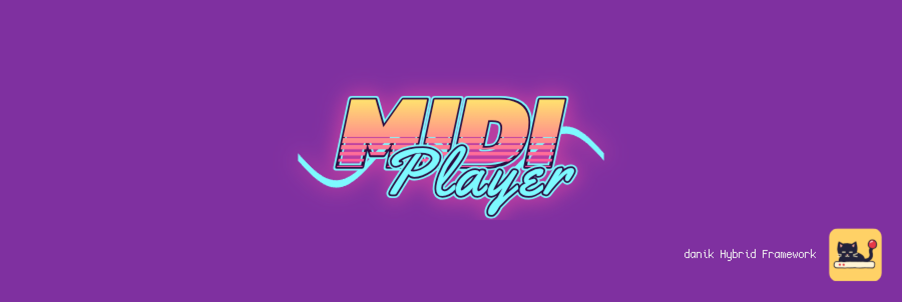
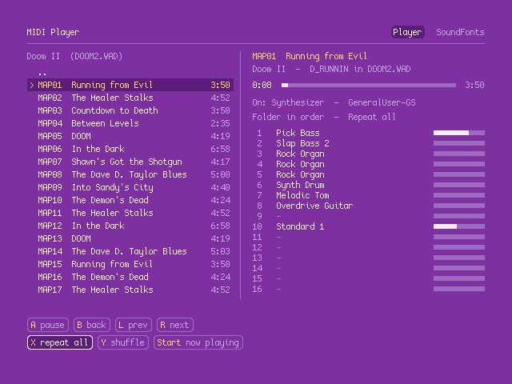
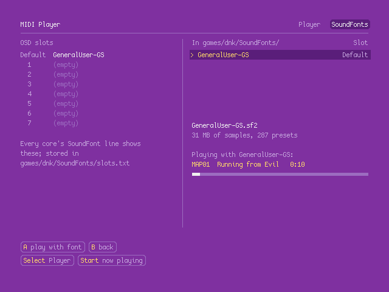

# MIDIPlayer for MiSTer

MIDI Player on [MiSTer FPGA](https://github.com/MiSTer-devel/Main_MiSTer/wiki) as a hybrid port.

MIDI Player plays MIDI files, and the music in the games of the installed hybrid ports, on the core's MIDI synthesizer with any SoundFont, or on an [MT32-pi](https://github.com/dwhinham/mt32-pi) when one is connected. It is also where the SoundFonts are chosen: it sets the 8 slots of the *SoundFont* line that every hybrid port with MIDI music has in its OSD. The program is ours (`midiplayer/`, C against the framework's `MH_` library) and runs on the MiSTer's ARM CPU. The MIDIPlayer FPGA core provides the synthesizer (128 voices, SoundFont 2, reverb and chorus), native 15kHz video (CRT, VGA and HDMI) at 640x480, 44.1kHz audio and keyboard, mouse and gamepad input. The two halves talk through shared DDR3 memory.

> **Beta.** Expect rough edges and please report problems in the issues.
>
> **Disclaimer:** AI is being extensively used to speed up development, but the project is well-maintained and supported.

  
  

## Requirements

- **danik_hybrid_ports**, the launcher: run it **once** from the MiSTer's `Scripts` menu ([The launcher](#the-launcher)). Without it the core says "Game not running".
- **Songs**, which are not included: your own MIDI files, or the music of the installed ports CrispyDoom (Doom, Doom II, Final Doom, Heretic, Hexen, Strife) and jfSW (Shadow Warrior), read from their games' files where they are. GeneralUser GS, the SoundFont, comes with the player (`games/dnk/SoundFonts/GeneralUser-GS.sf2`, its licence next to it); your own `.sf2` files can go in the same folder.

## Installation

With `update_all` (Downloader 2.4 or newer, which update_all keeps up to date):

1. Copy [`downloader_danik_hybrid_ports.ini`](https://raw.githubusercontent.com/ItsDanik/Hybrid_MiSTer/main/launcher/downloader_danik_hybrid_ports.ini) to the root of your SD card (`/media/fat`).
2. Run `update_all`. That installs the launcher, **danik_hybrid_ports**, in `Scripts`.
3. Run **danik_hybrid_ports** from the `Scripts` menu, tick the games you want and press *X: Apply*. They are installed, and update_all keeps them up to date.
4. Copy your MIDI files, in folders if you like, to `/media/fat/games/dnk/MIDIPlayer/`: `.mid`, `.midi`, `.kar` and Doom's `.mus` files are played. Your own SoundFonts go to `/media/fat/games/dnk/SoundFonts/`.
5. Load the player from the `Other` menu: **dnk-MIDI Player**, or from the `Hybrid Ports` folder if you moved the hybrid ports there in the launcher.

> [!NOTE]
> The songs can go on a USB drive instead, into the same folder there (`/media/usb0/games/dnk/MIDIPlayer/`): the player looks for them there first, and then keeps its settings there as well. SoundFonts can be on a USB drive too (`/media/usb0/games/dnk/SoundFonts/`), whose folder then wins over the SD card's for every core.

> [!IMPORTANT]
> **HDMI or VGA:** if you play on HDMI or on a VGA monitor rather than a 15kHz CRT, open the OSD and set *HDMI Only* to **Yes**. The MIDI Player's page is drawn at 640x480, which is interlaced for a CRT and shows combing on any other screen without it.

The player remembers the folder, the song selected, its SoundFont, the play order, repeat, and synthesizer or MT32-pi in `games/dnk/MIDIPlayer/midiplayer.cfg`. The OSD's SoundFont slots are in `games/dnk/SoundFonts/slots.txt`. The log is `/media/fat/logs/dnk/MIDIPlayer/midiplayer.log`.

## The Player page

On the left the songs: *My songs* first, then a folder for each game of the installed ports, Doom's music named by map and title ("E1M1  At Doom's Gate"). On the right what plays: the time, where it plays and with which SoundFont, the play order, repeat, and the 16 channels with their instruments and levels. The song goes on while you move through other folders or the SoundFonts page.

## The SoundFonts page

On the left the 8 slots of the OSD line *SoundFont* (*Default* and 1 to 7), on the right the fonts of `games/dnk/SoundFonts/`. A font over 64 MB of samples, or a damaged one, cannot be chosen.

- **A on a font while music plays**: the music goes on with that font, and the player keeps it as its own.
- **A on a font while nothing plays**: choose a slot for it on the left, and A puts it there. Or choose a slot first (Left / Right move between the lists) and press A: the font selected on the right goes in it. X clears a slot. A font can be in several slots.

Every core reads the slots when its game loads a SoundFont, so a change reaches a game the next time it starts.

## The launcher

**danik_hybrid_ports** is what turns a menu entry into a running game. Once you've run it from the `Scripts` menu, it starts with the MiSTer, watches which core is loaded, and starts the game whenever a hybrid port's menu entry is loaded. It serves all our hybrid ports at once and updates itself through `update_all`.

Run it from the `Scripts` menu again whenever you want to change something. Its screen has:

- **Launcher**: on or off. Off, the ports' games no longer start (the core says "Game not running"), until you turn it on again.
- **Menu entries**: where the games appear in the MiSTer menu:
  - **Other, as dnk-\<Title\>**: each game in the `Other` menu, e.g. **dnk-Doom** (the default).
  - **Other/Hybrid Ports**: all of them in a *Hybrid Ports* folder in `Other`, without the `dnk-` in front.
  - **Main menu/Hybrid Ports**: a *Hybrid Ports* folder of its own in the main menu, next to `Arcade`, `Console` and `Other`.

  Moving them keeps each game's settings and button mappings. Favourites, recent lists and Zaparoo tags that point at the old place have to be made again.
- **The ports and their games**, a tickbox each. Tick what you want, untick what you don't.

*X: Apply* installs what is ticked and removes what is not, through Downloader, and moves the menu entries if you chose another place. When a port is removed, your game data, saved games and settings stay, and ticking it again brings it back as it was.

## OSD options

| Option | |
|---|---|
| Aspect ratio, Scale, Scandoubler Fx, Stereo Mix | as in other cores |
| FPS Counter | shows the pictures per second in the top left corner |
| HDMI Only | **Yes** if no CRT is connected: resolutions of 640x400 and more are then progressive instead of interlaced, and so is the core's own screen before the game, which moves at 60 pictures a second for a CRT and shows fine lines on HDMI without it, as does the MIDI Player's page at 640x480. The analog output is switched off while one is shown, so that a 15kHz screen can never get such a signal. Nothing changes at lower resolutions. Not needed with `forced_scandoubler=1` (VGA monitor); not there with `direct_video=1` |
| CRT Options | **Horizontal Size**: the picture's width **Horizontal Pos**: moves it left or right **Vertical Pos**: moves it up or down **Flicker Filter**: Light (default), Strong or Off: softens fine lines that blink while the picture is interlaced  For a 15kHz screen: fits the picture to it. HDMI is not affected but by the Flicker Filter; not there with `forced_scandoubler=1` |
| MT32-pi | **MT32-pi**: On (default) or Off **MT32-pi Synth**: SoundFont or MT-32 **MT32-pi ROM**: MT-32 v1, MT-32 v2 or CM-32L **MT32-pi SoundFont**: *Pi's own* (default) or 0 to 7 of its card **Reset Hanging Notes**: silences notes left playing  Only there while an MT32-pi answers on the MiSTer's user port. Whether the music goes to it is the player's choice (`P`, or a click on the *On:* line) |
| Reset | starts the MIDI Player again from its beginning, as the USER button does |
| Save Diagnostic Report | the last line: see [If something is wrong](#if-something-is-wrong) |

## Controls

- **Keyboard and mouse:**

| Key | Action |
|---|---|
| Arrows, PgUp / PgDn, Home / End (or the wheel) | Move through the list |
| Enter (or double-click) | Play a song, open a folder |
| Backspace (or click `..`) | Back up a folder |
| Space (or the *A* button) | Pause / play |
| `,` / `.` (or their buttons) | Previous / next song |
| `R` (or its button) | Repeat: off, one, all |
| `S` (or its button) | Shuffle |
| `G` (or its button) | Go to the song playing |
| Tab (or the tabs) | Switch page |
| `P` (or the *On:* line) | Synthesizer / MT32-pi |
| Left / Right (or the progress bar) | Seek 5 seconds |
| `1`..`0` (or click a channel) | Mute a channel |
| Shift with `1`..`0` (or right-click a channel) | Solo a channel |

- **Gamepad** (default mapping):

| Button | Action |
|---|---|
| D-pad, left stick | Move through the list |
| A (Xbox B / PlayStation Circle) | Play a song, open a folder; on the song playing, pause / play |
| B (Xbox A / PlayStation Cross) | Back up a folder |
| X (Xbox Y / PlayStation Triangle) | Repeat: off, one, all |
| Y (Xbox X / PlayStation Square) | Shuffle |
| L (LB / L1), R (RB / R1) | Previous / next song |
| Select | Switch page |
| Start | Go to the song playing |

Change the buttons in the OSD under *Define MIDIPlayer buttons*. *Menu OK* and *Menu Back* there are only needed for a spare button without a game function. While the OSD is open, the game gets no input.

> [!WARNING]
> A button left without a name in *Define MIDIPlayer buttons* does not reach the game at all, except L2/R2, L3/R3 and *Menu OK* / *Menu Back*. Name every button there, or leave the definition as it is. To go back to the default buttons, delete `config/inputs/MIDIPlayer_input_*_v3.map` on the SD card.

## If something is wrong

If the sound breaks up or something else is wrong, open the OSD while it happens and pick **Save Diagnostic Report**, the last line of the menu. The player keeps running; MiSTer's info box says the report is saved in `games/dnk/diagnostics/` on the SD card. Send that file (`MIDIPlayer_<date>_<time>.zip`) with a few words on what went wrong.

The report has the setup (versions, the video and audio lines of `MiSTer.ini`, the OSD settings), how the last 60 seconds went, the log and a screenshot. Nothing else: no network settings, addresses, saved games or lists of your files.

## Building

How the port works, how to build it and notes for development: [NOTES.md](NOTES.md).

## Support

If you enjoy this project, you can support my work on [Patreon](https://www.patreon.com/itsdanik).

## Credits

- **[FluidSynth](https://www.fluidsynth.org)**, on which the synthesizer is modelled; its reverb is Freeverb by Jezar at Dreampoint.
- **[GeneralUser GS](https://schristiancollins.com/generaluser.php)** by S. Christian Collins: the SoundFont of the core's MIDI synthesizer, which comes with the port, its licence next to it.
- The Doom music titles are the [Doom Wiki](https://doomwiki.org)'s.
- **[MiSTer](https://github.com/MiSTer-devel)** by Sorgelig and the MiSTer-devel contributors: the framework and Template_MiSTer.
- **[MiSTer Frontier](https://github.com/MiSTerOrganize/MiSTer_Frontier)** by MiSTer Organize: thank you for the inspiration. Hybrid cores on the MiSTer, and the way their game is launched (a daemon that watches the loaded core and runs a script from its games folder), were inspired by MiSTer Frontier.

This project and its maintainers are in no way associated with or endorsed by the rights holders of the games whose music it plays. It does not include any game data.

## License

The top-level scripts, tools and documentation are licensed under the [GPL-3.0](LICENSE). The components keep their own licenses: MIDI Player (`midiplayer/`) is GPL-3.0, the part of the shared framework the game is linked with (`hybrid/hps/`) is GPL-2.0-or-later, the rest of `hybrid/` GPL-3.0 except where its files say otherwise, the FPGA core and the MiSTer framework are GPL-2.0 (`core/LICENSE`, with the core's own sources GPL-2.0-or-later).
